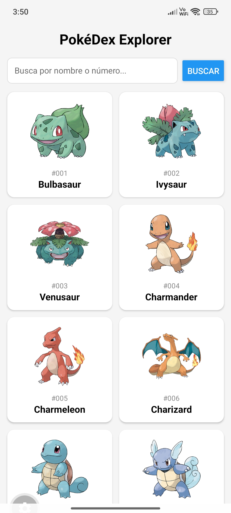
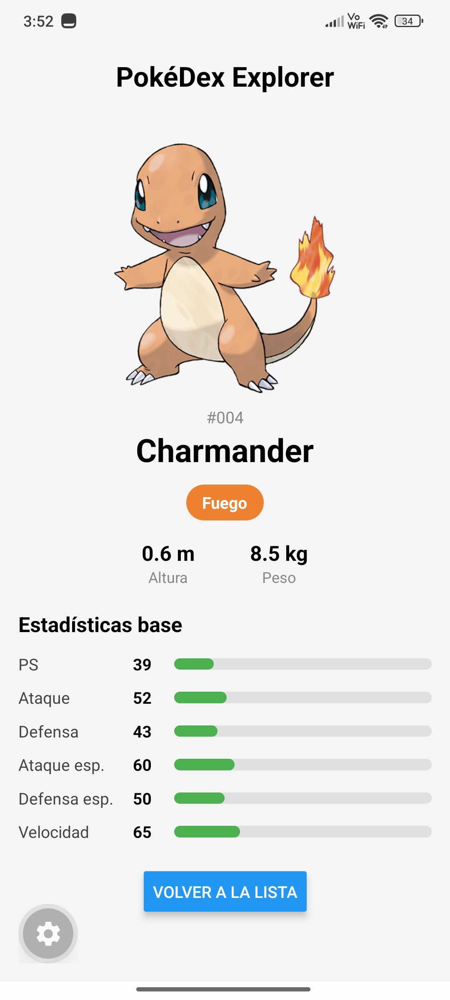

# PokéDex Explorer

App móvil hecha con React Native y Expo que consume la [PokéAPI](https://pokeapi.co/). Lista Pokémon con scroll infinito, permite buscarlos por nombre o número y muestra su ficha con imagen, tipos y estadísticas.

**Autor:** Robert De Jesús Julio González 
**Curso:** Desarrollo Movil· **Docente:** Paula Andrea Muñoz Correa

## Cómo ejecutarla

```bash
npm install
npx expo start
```

Escanea el QR con Expo Go, o presiona `a` (Android) o `i` (iOS).

## Funcionalidades

- Lista de 20 Pokémon en cuadrícula de 2 columnas, con scroll infinito.
- Búsqueda por nombre o número (ignora mayúsculas y espacios).
- Ficha con imagen, tipos con color propio, altura, peso y 6 estadísticas base.
- Estados de la interfaz: cargando, error con botón "Reintentar", sin resultados y éxito.

## Arquitectura

```
pokedex-explorer/
├── App.js
└── src/
    ├── services/
    │   └── pokeapi.js
    ├── screens/
    │   ├── PokemonListScreen.js
    │   └── PokemonDetailScreen.js
    ├── components/
    │   ├── PokemonCard.js
    │   ├── SearchBar.js
    │   ├── TypeBadge.js
    │   └── StatBar.js
    └── utils/
        ├── pokemon.js
        └── pokemonTypes.js
```

| Archivo | Responsabilidad |
|---|---|
| `App.js` | Punto de entrada. Decide si se muestra la lista o la ficha según el Pokémon elegido. |
| `src/services/pokeapi.js` | Toda la lógica de red: `fetch`, revisión de `response.ok` y transformación de las respuestas. |
| `src/screens/PokemonListScreen.js` | Pantalla de la lista: scroll infinito, búsqueda y sus estados. |
| `src/screens/PokemonDetailScreen.js` | Pantalla de la ficha: pide el detalle y maneja sus estados. |
| `src/components/PokemonCard.js` | Tarjeta con imagen, número y nombre. |
| `src/components/SearchBar.js` | Campo de texto y botón "Buscar". |
| `src/components/TypeBadge.js` | Distintivo de color para cada tipo. |
| `src/components/StatBar.js` | Barra de ancho proporcional para una estadística. |
| `src/utils/pokemon.js` | Funciones de apoyo: sacar el id de la URL, armar la imagen y formatear número y nombre. |
| `src/utils/pokemonTypes.js` | Colores de los tipos y traducciones al español. |

### Por qué esa organización

- **Separación de responsabilidades:** las llamadas a la API viven solo en `services`, y los componentes y pantallas solo se ocupan de la interfaz. Si la API cambia, se modifica un único archivo.
- **Componentes reutilizables:** `PokemonCard` se usa tanto en la lista como en el resultado de la búsqueda.
- **Utilidades aparte:** las funciones puras de `utils` no dependen de React, así que son fáciles de entender y de probar.
- **Sin librerías de red:** se usa `fetch`, que ya viene incluido.

## Flujo de ramas

- `main`: versión estable, la que se entrega.
- `dev`: integración de todas las ramas de trabajo.
- Ramas de trabajo (`setup/...`, `feature/...`, `docs/...`): salen de `dev` y vuelven a `dev`.

## Capturas

| Lista | Búsqueda | Ficha |
|---|---|---|
|  |  |  |

Ver la carpeta `screenshots/` para todos los estados (cargando, error y sin resultados).

## Reflexión

1. ¿Cómo influye el array de dependencias de useEffect en las peticiones a la API?
**Respuesta:**
El array de dependencias controla exactamente cuándo se ejecuta la función del efecto. Si se pasa un array vacío [], la petición se ejecuta únicamente una vez al montar el componente, lo cual es ideal para la carga inicial de los primeros 20 Pokémon. Si se omitiera el array, el efecto se ejecutaría infinitamente en cada renderizado de React, saturando la red

2. ¿Por qué es importante separar la lógica de red (peticiones API) de los componentes de la interfaz?
**Respuesta:**
Separar la lógica de red en un archivo dedicado (services/api.js) garantiza el principio de responsabilidad única y desacopla la interfaz de usuario. De esta forma, si el endpoint, la URL o la estructura de la PokéAPI cambian, solo debemos actualizar el archivo de servicio sin tocar la lógica visual, los estados o las hojas de estilo de los componentes React Native.

3. ¿Por qué FlatList y no ScrollView con map?
**Respuesta:**
FlatList dibuja solo los elementos que se ven en pantalla, así que aguanta listas largas sin gastar tanta memoria. Con ScrollView y map se dibujarían todos los Pokémon cargados a la vez. Además, FlatList ya trae numColumns para la cuadrícula y onEndReached para el scroll infinito.

4. ¿Qué problema tuve y cómo lo resolvi?
**Respuesta:**
En el scroll infinito aparecieron errores de claves duplicadas (same key): se estaba pidiendo dos veces la misma página. La causa era que el offset se calculaba con pokemons.length, que todavía no se había actualizado cuando onEndReached se disparaba por segunda vez. Lo resolvimos guardando el offset en un useRef, que se actualiza al instante, y usando otro useRef para no iniciar una petición mientras hay otra en curso.